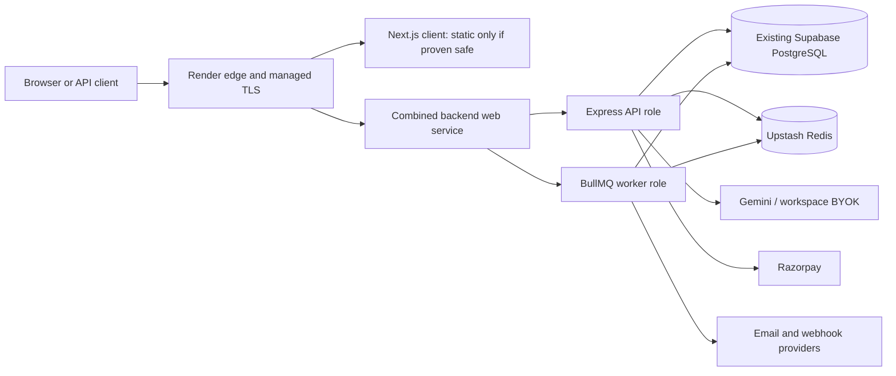
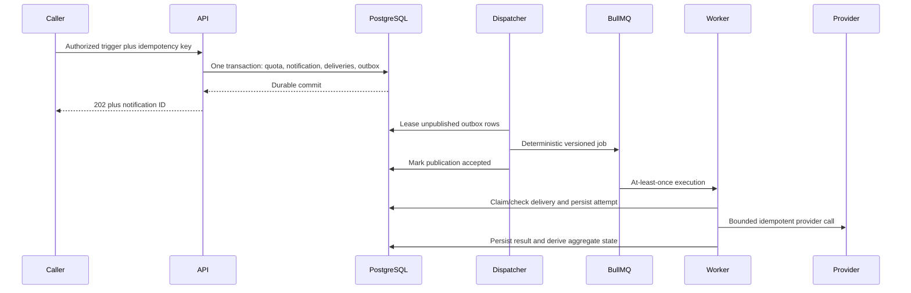

# Varta Production Readiness System Audit

**Audit date:** 2026-08-06
**Audited launch scope:** roadmap Phases 0–6, including Razorpay billing.
**Implementation source of truth:** current working tree in /home/iamsayon/Desktop/Projects/varta
**Engineering source of truth:** /home/iamsayon/Desktop/Data/CS-notes/1 - Absolute Engineering/Projects/Varta
**Audience:** maintainers responsible for taking Varta to its first production release

> **Execution-control update (2026-08-06):** Phase A foundation work is now
> preserved in commit `42f89f5` on `phase-a/reproducible-foundation`, rebased
> onto `main`. Sub-phases A1 and A2 are verified complete. Section 17 is the
> authoritative A–G implementation architecture and supersedes the older A–I
> remediation outline in section 10. `TASK_LIST.md` is the canonical minor-task
> checklist. Both Markdown files remain local and must never be committed.
>
> The release policy is one code line and one version for client, API, and
> worker. The ₹0 Render/Supabase/Upstash topology is the initial hosted profile
> for the public `v1.0.0` software release, not a separate demo code version.
> Render Free's vendor limitations still prevent an availability/SLA claim.
>
> Current database instruction: use the existing Supabase project directly.
> Database inspection is read-only and no migration, DDL, grant, RLS, or data
> mutation is authorized until the user explicitly approves it.

---

## 1. Executive verdict

Varta is **not ready for production**. It has a credible architectural direction and several useful implementation foundations, but the current tree cannot safely support the intended Phase 0–6 product. Razorpay billing and entitlement enforcement are now part of launch scope but are not implemented.

The most serious fact is not a cosmetic gap: a fresh database cannot be created from the committed migrations. Even if a database is provisioned manually, several central user journeys are either unavailable in the UI or fail because the client and server contracts disagree. The delivery pipeline contains state-consistency defects that can lose, duplicate, or permanently misclassify notifications. Several security controls described as complete are present only as unused helpers or documentation. The deployment pipeline is not release-gated, immutable, zero-downtime, or rollback-capable. The test suite is too small and too synthetic to detect these failures.

This is an **architecture-in-progress**, not a production-grade system. Passing TypeScript compilation and production builds prove that the source is syntactically coherent; they do not prove that the system works.

### Readiness scorecard

| Area | Score | Honest assessment |
|---|---:|---|
| Database and migration safety | 1/10 | Fresh migration fails; duplicate migration definitions drift from Prisma schema |
| Core Phase 0–5 product behavior | 2/10 | Major screens are disabled and multiple mounted flows cannot complete |
| Phase 6 Razorpay billing | 0/10 | Design is now locked; no billing module, schema, webhook, usage ledger, entitlement enforcement or checkout exists |
| Notification correctness | 2/10 | No atomic enqueue, broken reconciliation, status aggregation defect |
| Authentication and authorization | 3/10 | Solid primitives exist, but lifecycle, verification, scope and CSRF controls are incomplete |
| Tenant isolation | 3/10 | Controller checks exist; service/repository enforcement and database defense are absent |
| API contract quality | 2/10 | Client, server, specification and engineering standard disagree |
| Observability and operations | 3/10 | Basic stack exists; important metrics are inert and release operations are incomplete |
| Testing and verification | 1/10 | Eleven shallow server assertions; no integration, migration, browser, load or client tests |
| Performance and scalability evidence | 2/10 | Architecture anticipates queues, but capacity and query behavior are unproven |
| Maintainability and documentation | 3/10 | Useful modular intent, substantial drift, stale paths and contradictory completion claims |
| **Overall production readiness** | **2/10** | **No-go** |

### Release decision

**NO-GO.** Do not expose this system to real customer data or describe it as production-ready until all Phase A and Phase B exit criteria in this document pass.

### What is genuinely working

This audit is intentionally direct, but it is not claiming that nothing works:

- Server tests currently pass: 4 files, 11 assertions.
- Server TypeScript checking and production build pass.
- Client lint exits successfully, with 20 warnings under the current Next 16 rule set.
- Client TypeScript checking and production build pass.
- Prisma validates the current schema.
- Docker Compose configuration renders successfully.
- Shell scripts are syntactically valid.
- The Caddy configuration parses successfully.
- API and worker health endpoints, queues, Redis, PostgreSQL, pgvector, metrics, traces, dashboards and proxy configuration all have implementation scaffolding.
- Several defects from the previous audit were addressed: the proxy exposes TLS, Compose secret mounts are more coherent, API metrics are protected, Prometheus alert rules are present, migration execution occurs before service restart in the deployment script, and realtime pending-message acknowledgement is more sophisticated than the original fire-and-forget path.

Those are foundations. They do not offset the launch blockers below.

---

## 2. Audit boundaries and evidence

### Included

- The current repository working tree, including uncommitted and untracked files, because this is the implementation the user designated as the production source of truth.
- Server, client, Prisma schema and migrations, workers, queues, authentication, authorization, API contracts, realtime, AI/routing, observability, Docker/Compose, proxy, CI/CD and operational scripts.
- Root documents that existed before this report.
- Knowledge-base architecture, engineering standards, security, testing, observability, decisions and Phase 0–6 roadmap material.
- Static analysis plus safe local commands that did not mutate product data.

### Excluded or unknown

- Any production cloud account, DNS zone, certificate, external provider account, production database or live deployment.
- Vulnerability-database and license-database results that require external network access.
- Production migration state, traffic, latency, error rates, backups and restore history.
- Real email-provider delivery, OAuth-provider callbacks, webhook-provider delivery and real browser E2E behavior.
- **Environment readiness is acknowledged but intentionally deferred. Environment variables and secret-file defects are not findings in this audit, per instruction.**

An item marked **UNKNOWN** is not complete. It requires evidence before launch.

### Commands and results

| Check | Result |
|---|---|
| Server unit tests | PASS — 4 files, 11 assertions |
| Server typecheck | PASS |
| Server build | PASS |
| Client lint | PASS WITH 20 WARNINGS |
| Client typecheck | PASS |
| Client production build | PASS |
| Client standalone runtime smoke | PASS — HTTP 200 |
| Server production image (Node 24.18.0) | PASS |
| Client production image (Node 24.18.0) | PASS |
| Frozen root lockfile install | PASS — supply-chain policy verifies 1009 entries |
| Direct dependency freshness | PASS with intentional exceptions — client ESLint 9/TypeScript 6 pinned for peers; Node type definitions pinned to runtime major 24 |
| Prisma schema validation | PASS |
| Fresh migration deployment into disposable PostgreSQL 16 + pgvector | **FAIL** — first migration references relation workspaces before it exists |
| Seed command | **FAIL** — server/prisma/seed.ts does not exist |
| Compose configuration render | PASS |
| Shell script syntax | PASS |
| Caddy configuration parse | PASS WITH formatting warning |
| Git whitespace check | **FAIL** — trailing blank line in server/prisma/schema.prisma |
| Browser E2E suite | NOT PRESENT |
| Real PostgreSQL/Redis integration suite | NOT PRESENT |
| Client test suite | NOT PRESENT |
| Load/capacity test | NOT PRESENT |
| Dependency vulnerability audit | UNKNOWN |
| Recovery drill | UNKNOWN |

### Evidence discipline

Documentation, checked boxes, successful compilation and the presence of an implementation file are not accepted as proof of a working capability. A capability is complete only when:

1. its contract is defined;
2. its implementation works end to end;
3. security and failure behavior are defined;
4. automated tests exercise the real boundary;
5. production telemetry makes it observable; and
6. an operator can deploy, recover and roll it back.

---

## 3. Intended system and observed system

The knowledge base describes a multi-tenant notification platform with:

- a Next.js dashboard;
- an Express API;
- PostgreSQL and Prisma as the system of record;
- Redis and BullMQ for asynchronous processing;
- channel workers for email, in-app and webhook delivery;
- templates, subscribers, routing rules, analytics and AI-assisted routing/STO;
- authentication, workspace RBAC and scoped API keys;
- realtime delivery over WebSocket;
- Prometheus, Grafana and OpenTelemetry;
- containerized, TLS-terminated production deployment.

The repository broadly resembles this topology. The problem is at the seams:

1. persistence cannot be reproduced from migrations;
2. the dashboard does not expose most promised capabilities;
3. mounted clients call incompatible server contracts;
4. acceptance is recorded before durable queueing;
5. workers and aggregate status use inconsistent channel representations;
6. authorization helpers exist without enforcement;
7. telemetry definitions exist without instrumentation;
8. the release workflow builds a mutable host checkout independently of CI.

The dominant risk is therefore **integration correctness**, not absence of folders or architectural vocabulary.

---

## 4. Launch blockers — critical findings

### C-01 — A fresh database cannot be migrated

**Evidence**

The migration chain starts with additive migrations that alter or reference existing tables. In a disposable PostgreSQL 16 instance with pgvector, prisma migrate deploy fails in 20260720_ai_foundation because relation workspaces does not exist. There is no baseline migration that creates the core schema.

The later migrations 20260720_phase3_ai_layer and 20260731_subscriber_engagement_vectors also both create subscriber engagement vector storage with incompatible nullability/default behavior. IF NOT EXISTS hides the conflict rather than reconciling it. The resulting database depends on which historical path was used and does not necessarily match schema.prisma.

**Impact**

- New production, staging, CI and disaster-recovery databases cannot be created reproducibly.
- A restore into an empty environment is not possible using the repository alone.
- Prisma schema validation gives false confidence because it does not validate migration history.
- Existing databases may differ silently from one another.

**Required fix**

1. Inventory the exact intended schema from schema.prisma and every migration.
2. Decide whether pre-production history may be squashed. If no shared production database exists, create one reviewed baseline migration from an empty database. If databases already exist, preserve history and add explicit repair migrations.
3. Remove duplicate/contradictory table creation from the canonical history.
4. Test empty install, upgrade from every supported prior state, and downgrade/restore procedure in isolated databases.
5. Add migration deployment to CI against real PostgreSQL with pgvector.
6. Store schema snapshots and migration checksums as release evidence.

**Acceptance**

- An empty database reaches the expected schema using only prisma migrate deploy.
- prisma migrate status reports no drift.
- A representative pre-release database upgrades without data loss.
- The application starts and a smoke fixture can be created after migration.

### C-02 — Core Phase 0–5 dashboard functionality is not shipped

**Evidence**

The production client build contains routes for analytics, notifications, rules, subscribers, templates and workflows, but these routes render FeatureUnavailable rather than the implemented feature components. The sidebar exposes only Settings. The dashboard has no active notification bell or WebSocket integration. Several unused feature components contain static mock rows or console-only behavior.

**Impact**

The now-removed knowledge-base task list declared the product complete even though
it is not accessible to users. Phase 1–5 cannot be considered delivered simply
because isolated components or server routes exist.

**Required fix**

Define the launch surface explicitly. For each in-scope route, either:

- wire the real component to a tested API and make it navigable; or
- remove the route and remove the capability from Phase 0–5 launch claims.

Delete obsolete mock implementations after the real flow is mounted. Add route-level loading, empty, permission, error and retry states.

**Acceptance**

An authenticated user can navigate every in-scope feature from the UI and complete its documented primary journey in browser E2E tests.

### C-03 — The public landing page makes unsupported product, scale, pricing and legal claims

**Evidence**

The landing page advertises push and SMS, provider failover, five or more channels, smart timing/fallback chains, pricing tiers, large event volumes, adoption figures, availability figures and “production” maturity. Push, SMS, workflow maturity and billing are not in the launch scope or are not implemented. No repository LICENSE file exists while the page claims MIT licensing.

**Impact**

This is a customer trust and legal-release blocker, even if backend code were correct. It may misrepresent capability, reliability, customers, pricing and license rights.

**Required fix**

- Replace all claims with verifiable present-tense facts.
- Remove fabricated metrics, social proof and capacity claims.
- Remove out-of-scope channels and billing/pricing claims.
- Add a real license only after the owner chooses one; otherwise remove the license claim.
- Have product/legal approve the final text.

**Acceptance**

Every public statement has an owner and evidence. The launch page matches the tested production capability matrix.

### C-04 — Notification acceptance is not atomic with queue publication

**Evidence**

The trigger path persists a notification with ENQUEUED state and separately adds BullMQ jobs. There is no transactional outbox. A Redis lock is used for idempotency, but it is not a durable bridge between PostgreSQL and Redis. If job creation fails after the database write, retry encounters the existing idempotency record and may return it without repairing missing jobs.

The duplicate path can also observe a lock before the first request has committed the notification, returning an incomplete/undefined result. Multi-channel publication can partially succeed.

**Impact**

The API can report acceptance while no deliverable job exists, or while only some requested channels exist. Retries cannot reliably heal the state. This violates the central product guarantee.

**Required fix**

Implement a PostgreSQL transactional outbox:

1. In one database transaction, create the notification and one outbox record per channel, guarded by a workspace-scoped idempotency constraint.
2. Have a dispatcher claim outbox rows with leases/SKIP LOCKED and publish deterministic BullMQ job IDs.
3. Mark publication only after BullMQ accepts the job.
4. Reclaim stale leases.
5. Return the existing committed notification for duplicate idempotency keys.
6. Define partial-channel semantics and a compensating repair path.

**Acceptance**

Fault-injection tests kill the process at every database/queue boundary and prove eventual publication exactly once logically, with safe at-least-once physical execution.

### C-05 — Mounted notification trigger and retry authorization cannot work correctly

**Evidence**

The route accepts either JWT or API-key authentication, but the controller unconditionally asserts req.apiKey workspace ownership. A valid JWT request therefore reaches a forbidden path because no API-key principal exists. Bearer API keys are also misclassified by the combined authenticator unless the x-api-key header is used. The scope middleware is not mounted.

**Impact**

The dashboard trigger/retry workflow fails for JWT users, and API-key authorization does not enforce declared scopes.

**Required fix**

- Introduce one explicit principal type: user-session or API-key, each with workspace, identity and capabilities.
- Authenticate once, then authorize the operation against that principal.
- Support only documented credential transports.
- Mount scope enforcement for API keys.
- Test user/admin/member/API-key/no-scope/wrong-workspace permutations through HTTP.

**Acceptance**

The same route succeeds for authorized JWT and API-key principals and fails with stable 401/403 responses for every invalid combination.

### C-06 — The mounted Studio request contract is incompatible with the server

**Evidence**

The current Studio posts subscriberId and channels at the top level, with an optional templateId. The server requires templateId, subscriberExternalId, payload, and options.channels. A separate, more accurate TriggerStudio implementation exists but is not mounted.

**Impact**

The primary mounted test-send experience fails validation before delivery logic is reached.

**Required fix**

Choose one canonical OpenAPI-style request/response schema and generate or share the TypeScript contract. Remove the duplicate Studio implementation, mount the canonical one, and add a browser test that creates a subscriber/template and sends a notification.

**Acceptance**

The request emitted by the production client is validated by the same schema consumed by the server and completes end to end.

### C-07 — First-time subscriber creation is broken

**Evidence**

The subscriber endpoint always performs upsert. On the create branch it forwards the request body to Prisma without injecting the route workspaceId required by the data model. The request schema also always requires externalId, so the documented create/update semantics are unclear.

**Impact**

The first creation of a subscriber can fail at runtime, blocking notification targeting.

**Required fix**

- Define create, update and idempotent upsert contracts separately or document one true upsert contract.
- Construct repository inputs explicitly, including workspaceId.
- Enforce workspace-scoped uniqueness.
- Test create, repeat upsert, conflict, update, delete and cross-workspace isolation against real PostgreSQL.

**Acceptance**

A new workspace can create its first subscriber through both the supported UI and API path.

### C-08 — Email attempts do not roll up to the notification’s EMAIL channel

**Evidence**

The email worker records its attempt channel as lowercase email. Notification channels are stored as uppercase EMAIL, and aggregate status recomputation uses exact matching. Successful email attempts are therefore not counted for the requested channel.

**Impact**

Email may be physically sent while its notification remains ENQUEUED or otherwise incorrect. Analytics, retries and user-visible status become unreliable.

**Required fix**

Use one channel enum at every boundary: API schema, database, queue payload, worker and aggregation. Backfill inconsistent rows and add database constraints where possible.

**Acceptance**

Integration tests prove every channel transitions through the defined state machine and aggregate status is correct for single- and multi-channel delivery.

### C-09 — Reconciliation can fabricate invalid delivery work

**Evidence**

The reconciliation worker recreates jobs with blank rendered content/subject, hard-coded provider information and an empty API-key identity. It cannot reconstruct the original provider configuration or rendered payload, ignores webhook work, only handles notifications with zero attempts, and can collide with retained BullMQ job IDs.

**Impact**

The recovery mechanism can send malformed notifications, use the wrong provider, miss partially lost channels, or fail to repair anything.

**Required fix**

Delete this behavior until it can be made correct. Reconciliation must operate from durable outbox/delivery records containing immutable references or encrypted snapshots sufficient to reproduce the original intent. It must reconcile per channel and never invent content or credentials.

**Acceptance**

Failure-injection tests demonstrate repair of zero-job and partial-job scenarios without changing rendered content, recipient, provider or idempotency identity.

### C-10 — Refresh-token rotation and reuse protection are not production-safe

**Evidence**

Refresh JWT contents lack a unique token identifier and can be deterministic for the same session within the same second. Rotation can therefore regenerate an identical token/hash. Concurrent refresh requests are not serialized into a safe token family. Revoked-token reuse is treated as a generic invalid token rather than a reuse event that revokes the family. Access and refresh tokens use symmetric HS256 while the knowledge-base production decision requires asymmetric ES256.

**Impact**

Rotation may fail under timing/concurrency, stolen-token reuse is not reliably detected, and key separation/rotation does not meet the documented security design.

**Required fix**

- Add cryptographically random jti values and explicit token families.
- Rotate in a database transaction using row locking or compare-and-swap.
- On reuse, revoke the family and all associated sessions, record a security event and require reauthentication.
- Enforce algorithm, issuer, audience, key ID and token type.
- Implement the documented asymmetric signing/key-rotation strategy or amend the approved architecture before launch.

**Acceptance**

Automated concurrency and replay tests prove one successful rotation, family revocation on reuse and rejection of algorithm/audience/type confusion.

### C-11 — Email provider webhooks are not authentically or idempotently processed

**Evidence**

The inbound webhook implements a custom hex HMAC construction instead of the provider’s Svix-compatible signed-message format and signature parsing. The event deduplication lookup checks delivery-attempt provider message IDs but the handler does not persist the inbound event ID. The request body is logged, and event payloads are neither robustly validated nor used to update delivery state, suppressions or analytics.

**Impact**

Valid provider events can be rejected, forged events may be trusted under the wrong scheme, duplicates are not actually deduplicated, sensitive payloads enter logs, and bounce/complaint/delivery state is lost.

**Required fix**

- Use the provider’s maintained verification library or implement its published algorithm exactly over the raw request body.
- Persist each provider event in a unique event ledger before processing.
- Validate event-specific schemas.
- Map provider message IDs to attempts and update state idempotently.
- Implement bounce/complaint suppression and audit records.
- Redact payloads from normal logs.

**Acceptance**

Captured provider fixtures cover valid, invalid, expired, duplicate, out-of-order, delivery, bounce and complaint events.

### C-12 — There is no release artifact or gated production deployment

**Evidence**

The audited implementation is a large dirty main working tree with many
modified/untracked files. Render is now the locked hosted target, but
`ops/deploy/render.yaml` is still an empty placeholder while the deployment
workflow SSHes to a VPS, pulls source, and builds mutable images in place. CI and
CD are separate workflows triggered from main and deployment does not consume a
CI-approved immutable artifact. There is no versioned image digest, release
manifest, automated rollback, Blueprint validation, or proven zero-downtime
rollout. Health checks are internal and do not prove the external Render HTTPS
path. The retained Caddy topology also disables automatic HTTP-to-HTTPS
redirects while its checklist says the redirect works.

**Impact**

The deployed code cannot be tied reliably to reviewed source and test evidence. A failed release can cause downtime and cannot be reverted predictably.

**Required fix**

1. Commit and review the intended release tree.
2. Replace the VPS CD path with a reviewed Render Blueprint for the initial ₹0
   hosted profile: static client if export-compatible, one combined API/worker
   web service, Supabase Postgres, and Upstash Redis. Preserve independently
   runnable API/worker entrypoints for the later paid topology.
3. Validate the Blueprint in CI and deploy only the exact passing commit or its
   signed/versioned immutable images and SBOM.
4. Gate deployment on all required checks and an environment approval.
5. Run migrations with compatibility rules before traffic switch.
6. Use Render's supported rolling/zero-downtime behavior with external smoke
   tests, appropriate shutdown delay, and a migration-safe release sequence.
7. Retain the previous release and prove Render rollback.
8. Verify Render TLS/redirect behavior; separately repair and retain the Caddy
   path as a tested self-hosting/reference implementation.
9. Prove sleep/wake catch-up, worker readiness inside the combined process,
   Supabase manual export/restore, and measured BullMQ command usage against
   Upstash quotas. Record one `v1.0.0` software GO with the free-hosting limits
   explicitly accepted; do not claim an infrastructure SLA.

**Acceptance**

A release record links commit, test results, migration, image digests and deployment. A deliberately broken candidate never receives traffic, and a rollback drill succeeds.

### C-13 — Razorpay billing and entitlement enforcement do not exist

**Evidence**

Phase 6 is now part of launch scope, but the repository has no billing module,
Razorpay client or checkout endpoint, product-plan/subscription schema, verified
payment-event inbox, billing queue/consumer, usage ledger, entitlement snapshot,
quota reservation, reconciliation job, owner-only billing UI, or billing tests.
The commercial catalog is now locked to Free, Plus, and Business with regional
INR/USD prices and account-wide workspace/member/subscriber/throughput/AI
entitlements, but the repository also lacks the required billing-account boundary
above workspaces.
The previous knowledge base proposed Razorpay plus Stripe, a speculative provider
abstraction, and daily-cron limit enforcement; those designs were unsafe and
have now been replaced with a Razorpay-only specification.

**Impact**

Varta cannot charge customers, determine paid access, enforce plan limits, or
reconcile payment state. Publishing pricing or accepting money before this is
implemented would create financial, entitlement, support, and trust failures.

**Required fix**

1. Implement the Razorpay-only design in the knowledge-base Phase 6 document.
2. Store versioned regional plans, a billing-account/workspace association,
   normalized account subscription state, a durable
   deduplicated event inbox, append-only usage ledger, and entitlement snapshot.
3. Verify Razorpay signatures over exact raw bytes and process events
   idempotently/out of order through a billing queue in the existing worker.
4. Enforce quota atomically in the same transaction as notification acceptance;
   scheduled reconciliation is a repair mechanism, not the enforcement path.
5. Build owner-only checkout/status/cancel flows; never trust client amount,
   plan identifiers, callback success, or entitlement data.
6. Exercise activation, renewal, payment failure, grace, cancellation, refund,
   duplicate/out-of-order event, concurrency, and missed-webhook reconciliation
   in Razorpay test mode.
7. Enforce the locked notification-run definition and exact Free/Plus/Business
   limits from the knowledge-base billing specification.

**Acceptance**

Every local entitlement transition is traceable to a verified Razorpay event or
audited reconciliation, concurrent requests cannot exceed quota, the browser
never receives a secret or grants access, and the complete test lifecycle passes.

---

## 5. High-severity findings

### H-01 — Email verification is not an authorization gate

RequireVerifiedUser exists but is not mounted on the protected operations reviewed. Unverified accounts can reach workspace, provider, template, rule and cost-bearing delivery functions.

**Fix:** define exactly which operations require verification, mount the policy centrally after authentication, and test every protected route. Keep low-risk resend/logout/session operations available.

### H-02 — API-key expiry and scopes are not enforced

API-key middleware verifies key material but does not reject expired keys. Scope enforcement is implemented as a helper and unit-tested directly, yet not mounted on the operational routes. Empty permissions effectively mean full access.

**Fix:** make expiry mandatory at authentication time; define deny-by-default scopes; map every API route to a capability; expose last-used/revocation audit data; run HTTP authorization tests.

### H-03 — API-key representation and response handling are unsafe/inconsistent

The API accepts a JSON object for permissions while the client and specification use arrays. The client expects keyPrefix while the server returns prefix. Creation spreads the database object and adds fullKey, potentially returning keyHash. Client auth state also supports storing a raw API key in localStorage.

**Fix:** define a single permissions model; return a purpose-built response DTO containing only id, name, prefix, timestamps, permissions and the one-time full key; never return hashes; remove persistent browser storage for raw service credentials.

### H-04 — OAuth account linking and secret storage do not meet the design

OAuth account linking trusts matching email without consistently requiring provider-verified email. Provider access/refresh tokens are stored in plaintext. OAuth registration performs multiple writes without a transaction. Its callback redirects to a dashboard route that does not exist, while the client callback route is different and OAuth UI is disabled/stale.

**Fix:** require verified provider identity, encrypt provider tokens with key rotation, transact bootstrap writes, define account-link confirmation/risk rules, and implement one tested callback flow with state/PKCE/nonce as applicable.

### H-05 — Authentication bootstrap writes are not transactional

Registration and OAuth bootstrap create user, workspace, membership, session and token records across multiple writes. A mid-flow failure can leave orphaned or partially initialized accounts.

**Fix:** put database writes in one transaction, perform email side effects through an outbox after commit, and make retries idempotent.

### H-06 — Logout/refresh cookie endpoints lack a proven CSRF/origin policy

A same-origin/CSRF helper exists but is unused and its prefix matching is not a safe origin comparison. Cookie policy differs from the Strict policy in the knowledge base. Logout may not be idempotent when the cookie is absent.

**Fix:** use exact parsed Origin/Host allowlisting plus CSRF tokens where cross-site cookies are required; make logout idempotent; test cross-origin form and fetch attacks.

### H-07 — Provider configuration can disclose or corrupt secrets

Provider list decrypts configurations and masks only field names containing secret or key. Generic provider fields named token, password, credential or arbitrary vendor names may be returned. A client can later write masked placeholders back.

**Fix:** introduce provider-specific schemas with explicit secret fields, separate secret write-only endpoints/DTOs, return only safe metadata, and preserve an existing secret when no replacement is supplied.

### H-08 — Tenant authorization is concentrated in controllers

Many services and repositories accept workspaceId without a principal/capability and can be called unsafely from a new controller, job or internal path. Template update/delete performs an earlier controller check but mutates by id alone. No PostgreSQL row-level security or restricted runtime-role defense is present.

**Fix:** establish a service authorization boundary, require WorkspaceContext/Principal, include workspaceId in mutation predicates, and evaluate defense-in-depth RLS using a restricted runtime role. Add cross-tenant property tests.

### H-09 — Role policy disagrees across code and documentation

Members can mutate templates and subscribers in routes where the knowledge base says administrator access is required. Provider read is administrator-only while the specification describes member access. API-key listing is less restrictive than the specification. Member invitation/update/removal endpoints described by the roadmap are absent.

**Fix:** approve one RBAC matrix, encode it as policy tests, generate documentation from the same matrix, then remove route-local improvisation.

### H-10 — The API contract standard is not implemented

Responses use success/data or flat error objects instead of the documented data + meta.requestId and nested error envelope. No request-ID middleware consistently returns/propagates a correlation ID. Lists use mixed page/offset/unbounded patterns rather than the documented cursor pagination.

**Fix:** define shared response/error/pagination primitives, add request ID at ingress, carry it through logs/outbox/jobs/attempts, and migrate endpoints deliberately with contract versioning.

### H-11 — Queue payload schemas are inconsistent and mostly unenforced

Only the email worker validates a job schema. In-app’s schema expects content while the producer/worker uses renderedContent; its test validates the wrong contract. Webhook, digest, send-time optimization and reconciliation jobs do not consistently parse a versioned payload. Request IDs and schema versions are missing.

**Fix:** define a versioned discriminated schema per queue, validate at publish and consume, reject/park unsupported versions, and test real producers against real consumers.

### H-12 — Webhook delivery remains vulnerable to network abuse and hanging

The worker resolves a hostname to validate it, then performs a fetch that resolves it again, leaving a DNS-rebinding window. Reserved-range coverage is incomplete and the validated address is unused. Provider HTTP/SDK calls generally lack enforced timeouts.

**Fix:** route outbound webhooks through a controlled egress service or pin the validated address safely while preserving TLS hostname verification; deny all private/link-local/metadata ranges for IPv4/IPv6; cap redirects, body sizes and time; add provider timeouts/cancellation and egress policy.

### H-13 — Provider implementations are not all production-correct

SES is explicitly non-functional outside tests. Mailgun derives the domain from a display From string, and SendGrid receives a display string where an address structure is expected. Provider errors, timeouts and retryability are not normalized consistently.

**Fix:** support only providers that pass contract tests; disable/remove incomplete adapters from production selection; parse From into a typed mailbox; normalize message IDs and failure taxonomy; test provider sandboxes.

### H-14 — Realtime delivery conflates received and read

The worker marks an attempt successful after buffering/publish, not after device receipt. WebSocket ACK sets both delivery and notification read state, and the client auto-ACKs received messages, so merely arriving makes a notification read. Pending rows can race because there is no uniqueness constraint, and the server flushes only a bounded first page.

**Fix:** model queued, published, device-delivered, displayed and user-read as separate events. ACK delivery without setting readAt; add an explicit read endpoint/event; enforce unique pending identity and drain pages until complete.

### H-15 — Realtime is not integrated into the shipped dashboard

The current dashboard does not establish the documented WebSocket client/bell flow. Token issuance is designed around workspace users but subscriber/client authentication semantics are not clearly defined.

**Fix:** define whether realtime serves dashboard operators, end subscribers, or both; create separate auth models if necessary; mount the client with reconnect/resume semantics and browser tests.

### H-16 — Digest state transitions are premature and non-recoverable

Digest source notifications remain ENQUEUED, while an aggregate can be marked DELIVERED immediately after a delivery job is merely enqueued. Lease renewal/heartbeat, schema validation and robust retry/reopen semantics are absent.

**Fix:** define a digest batch state machine; persist membership; mark delivery only from a successful attempt; heartbeat/reclaim leases; make retries idempotent; test worker crashes and duplicate schedules.

### H-17 — Routing precedence and fallback behavior are unresolved

The repository sorts ascending priority while knowledge-base material conflicts between lower-number-wins and descending-priority language. Requested channel overrides are applied after rule matching although the documented flow describes override first. A fallback field exists but is ignored.

**Fix:** make an architecture decision, migrate existing data if needed, implement one deterministic evaluator, delete unused semantics, and test tie/override/fallback behavior using the production function.

### H-18 — The analytics and routing clients call incompatible APIs

The analytics client sends timeRange=7d while the server requires ISO from/to. The rule builder calls /rules while the server mounts /routing-rules. Settings expects a single provider object while the server returns an array. The API-key client uses the incompatible fields described above.

**Fix:** produce a canonical contract package/OpenAPI schema and make client generation or shared validation part of CI. Add contract tests for every mounted client call.

### H-19 — Observability advertises signals that are never emitted

Delivery, queue-failure, queue-depth and active-worker metrics are declared, but reviewed worker paths do not update them. Prometheus alerts and Grafana panels therefore query absent/empty series. AI metrics are stored in an in-process Map or logs rather than exported to Prometheus. OpenTelemetry uses a debug exporter rather than a durable backend.

**Fix:** instrument every state transition and queue event, export AI metrics through the same registry without tenant-ID cardinality, add recording rules/SLOs, configure trace storage, and test alerts by injecting failures.

### H-20 — CI does not validate the architecture’s real boundaries

CI does not provision real PostgreSQL/pgvector and Redis for migration/repository/queue tests, has no browser E2E, no migration-upgrade matrix, no coverage threshold, no dependency/license policy evidence and no image/security release gate.

**Fix:** build a staged pipeline: formatting/static checks; unit tests; database/Redis integration; migration tests; provider-contract tests; browser E2E; image/SBOM/security policy; immutable publish; deployment approval.

---

## 6. Medium-severity findings

### M-01 — Password rules are internally inconsistent

Registration enforces composition while password reset only enforces length. The knowledge base also cites NIST guidance that conflicts with composition rules. Choose one approved password policy, apply it through one shared schema and add breached-password/rate-limit considerations if required.

### M-02 — Email side effects are silently swallowed and sensitive links reach logs

Verification/reset delivery errors can be caught while the API reports success, with no durable retry record. Development logging emits full addresses and raw verification/reset URLs. Use an email outbox, redaction, safe preview tooling and observable failure state.

### M-03 — Access-token revocation semantics are undocumented

Access authentication does not query session revocation, so a revoked session’s access token can remain valid until expiry. This can be acceptable only with a short TTL and an explicit risk decision. Document and test the chosen behavior.

### M-04 — Error typing and validation are inconsistent

Some domain validation throws generic errors that become 500 responses; query parsing can accept NaN, negative pagination or unbounded ranges. Replace generic errors with typed stable codes and validate every request boundary.

### M-05 — Pagination is unsafe or absent

Notification pagination is not robustly clamped. Workspaces, members, sessions, providers and routing lists are unbounded. Offset pagination conflicts with the cursor standard and becomes unstable at scale. Add bounded cursor pagination and deterministic sort keys.

### M-06 — Analytics queries are unbounded and cache behavior is weak

Arbitrary time spans can cause expensive raw queries. Cache invalidation is absent and concurrent misses can stampede. Add maximum ranges/resolution tiers, workspace-aware indexes, EXPLAIN evidence, cache versioning/invalidation and single-flight behavior.

### M-07 — Send-time optimization reads raw events into memory

The service loads engagement events and aggregates in application memory, then writes subscribers sequentially. One invalid timezone can disrupt a run. Use database aggregation/batching, validate timezones at write time, bound history and parallelize safely.

### M-08 — Send-time scheduling behavior is questionable

When the preferred hour equals the current hour, delay calculation can choose the next day rather than immediate delivery. Nightly jobs are scheduled at worker startup for known workspaces, so new workspaces may wait for restart. Feature-disable behavior is incomplete. Define temporal semantics and use one durable scheduler.

### M-09 — Vector-index lifecycle has no operational plan

The IVFFlat configuration is fixed without measured dataset size, ANALYZE/reindex procedure, recall target or rollout plan. Validate pgvector query plans and use an index strategy appropriate to actual scale.

### M-10 — Rate limiting disagrees with the specification and fails open

Configured limits differ by route/principal from the written standards, lack consistent Retry-After metadata and fail open if Redis is unavailable. Define threat/cost-based limits for IP, user, workspace and API key; decide fail-open/fail-closed per operation; test degradation.

### M-11 — Backoff and DLQ semantics do not match the written design

Retries lack documented jitter. Some terminal webhook paths can return in a way that BullMQ considers complete while a separate record is called dead-lettered. There is no coherent operator workflow for inspection/replay. Standardize terminal state, DLQ storage, alert and replay.

### M-12 — Delivery credentials/content in Redis need an approved boundary

Some queue payloads include provider credentials/signing material and rendered content. This conflicts with the engineering standard favoring minimal identifiers and expands Redis compromise impact. Prefer encrypted database references/snapshots and short-lived retrieval; document any exception.

### M-13 — Database deletion/retention policy is incomplete

Many security, delivery and history records use hard deletes where loss can be operationally or legally significant. Retention, soft-deletion, purge and audit requirements are not encoded. Define per-entity lifecycle and implement scheduled, observable purge.

### M-14 — The database runtime has no demonstrated defense-in-depth isolation

No RLS policies or dedicated restricted runtime-role setup appear in migrations. Application checks remain the sole tenant boundary. Evaluate RLS and, at minimum, prove least-privilege roles for runtime, migrator and backup operations.

### M-15 — The metrics route can create undesirable cardinality

Fallback route labeling may use request paths when no Express route template is available. Unknown or parameterized paths can introduce high-cardinality labels. Normalize unmatched paths and verify req.route behavior through tests.

### M-16 — Monitoring services are exposed more broadly than the knowledge base promises

Prometheus and Grafana publish host ports while architecture notes describe internal-only access. There is no alert delivery service. Restrict network exposure, federate/authenticate deliberately and connect Alertmanager or an equivalent paging destination.

### M-17 — Grafana provisioning is duplicated

Both .yaml and .yml datasource/dashboard provider definitions exist for the same resources. This can produce duplicate provisioning/conflicts. Keep one canonical file for each.

### M-18 — The operations stack is not fully supervised

Caddy lacks the same resource/health supervision expected of core services. Some resource budgets are static guesses and worker concurrency differs from planning values. Add health checks, limits and measured capacity budgets.

### M-19 — Backup and restore are scripts, not a recovery capability

Backup/restore scripts now exist, which improves the previous state, but there is no evidenced encryption, offsite retention, integrity verification, schedule, monitoring, RPO/RTO, point-in-time strategy or restore drill. Restore is destructive and has no interactive target confirmation.

### M-20 — End-to-end operational runbooks are absent

The operations directory has scripts/configuration but no tested operator entry
point covering clean-host setup, deployment, rollback, queue repair, secret
rotation, provider disablement, backup, and restore. Add non-secret runbooks and
execute every command in staging.

### M-21 — Makefile migration behavior is unsafe/inconsistent

The generic migrate command uses prisma migrate dev, while production operations require migrate deploy. Give development and deployment commands unmistakable names and prevent development migration generation in a production context.

### M-22 — The seed contract is broken

Package and ops scripts advertise seeding, but server/prisma/seed.ts is absent and pnpm prisma:seed fails with ERR_MODULE_NOT_FOUND. Add a deterministic, idempotent non-production seed or remove every advertised seed command.

### M-23 — Client route protection is incomplete

The proxy route matcher omits some protected areas such as Studio, Notifications and Workflows, leaving protection to client layout behavior. It infers authentication from cookie presence rather than validity. Treat proxy checks as UX only and ensure every server operation authenticates; make route coverage consistent.

### M-24 — Workspace selection can become stale

The selected workspace is stored locally and is not clearly invalidated/revalidated after membership loss. Always reconcile selection against the authenticated membership response and fall back safely.

### M-25 — Frontend form/state patterns drift from standards

Forms and types are hand-built and duplicated despite documented shared Zod/React Hook Form conventions. Manual DTOs have already drifted. Consolidate domain contracts and use one form/error pattern.

### M-26 — Client lint debt is accepted as green

The production client builds with 20 warnings under the upgraded Next 16 lint
rules, including unsafe `any` usage, effect-driven state, direct browser
navigation and unused code. Make the warning budget zero or explicitly baselined
and ratcheted.

### M-27 — Repository layering is not consistently enforced

Controllers perform domain/data work, services directly combine Prisma, Redis and queues, repositories can return raw storage shapes, and modules import internal details across feature boundaries. Refactor around explicit application use cases and ports only where they simplify ownership.

### M-28 — Silent catches and fire-and-forget paths obscure failures

Several side effects are best-effort without durable recording or consistent structured error handling. Every ignored failure must be intentional, observable and safe to retry.

### M-29 — Documentation completion state is unreliable

**Remediated during this follow-up.** The false task list and duplicate phase
specifications were deleted; the knowledge base now has a truthful project state,
one canonical roadmap, and explicit status vocabulary. Future completion must
remain linked to acceptance evidence.

### M-30 — API and architecture version drift is unmanaged

**Knowledge-base portion remediated during this follow-up.** The current docs now
lock Caddy, lower-number-first routing, strict required-variable validation,
transactional outbox/versioned jobs, Node 24/TS split, backend AI placement, and
Razorpay-only billing. The implementation still differs from several target
contracts and remains open until code plus contract tests converge.

---

## 7. Lower-severity and hygiene findings

### L-01 — Git whitespace validation fails

server/prisma/schema.prisma contains an extra trailing blank line. Fix it and add format/diff checks to CI.

### L-02 — The release tree is not reviewable as one coherent change

The audit observed a very large dirty main worktree. Before remediation, split changes into reviewable commits with migration and contract changes called out explicitly.

### L-03 — Obsolete and duplicate client implementations reduce readability

Unmounted mock lists, stale editors and duplicate Studio components make it unclear which implementation is authoritative. Remove superseded code after a real flow is mounted.

### L-04 — Naming is inconsistent

Singular/plural route and module names differ across client, server and documents. Adopt a route/resource naming table and enforce it in generated contracts.

### L-05 — The Caddyfile is valid but not formatted

Run the canonical formatter and commit the result after correcting redirect behavior.

### L-06 — Public documentation currently has no basic project entry point

The user requested exactly one root Markdown file, so this audit intentionally occupies that role. Once the remediation program is complete, replace it with a concise README and move lasting audit history into the knowledge base.

### L-07 — No repository license exists

This is critical while the landing page claims MIT licensing, but otherwise a release-governance item. Choose and add the actual license only with owner authorization.

### L-08 — Dependency and transitive-license posture is unknown

No current external advisory/license scan was run under the audit boundary. Add lockfile-based scanning to CI and review exceptions before release.

---

## 8. Phase-by-phase implementation reality

The following status uses **Complete**, **Partial**, **Blocked**, or **Not delivered**. “Code exists” is not a completion state.

| Roadmap phase | Intended result | Observed result | Status |
|---|---|---|---|
| Phase 0 — foundation/auth/tenancy | Reproducible platform, auth, workspace RBAC, deployment base | Builds pass; fresh DB fails; auth lifecycle/RBAC gaps; release pipeline unsafe | **Blocked** |
| Phase 1 — email MVP | Subscribers, templates, providers, API keys, email trigger/logs | Endpoints/components exist; subscriber create, API scopes, Studio contract, email status and provider correctness fail | **Blocked** |
| Phase 2 — in-app/realtime/routing | WebSocket bell, ACK/read, routing rules | Server scaffolding exists; dashboard integration absent; ACK/read conflated; route contract mismatch | **Not delivered** |
| Phase 3 — analytics and AI | Analytics, rule compilation, STO/vector model | Backend work exists; analytics UI disabled/contract wrong; routing precedence conflict; STO unbounded/unproven | **Partial** |
| Phase 4 — digest/webhook/reliability | Digests, webhooks, reconciliation, resilient delivery | Workers exist; webhook trust, digest state and reconciliation are not safe | **Blocked** |
| Phase 5 — production hardening | Observability, tests, security, CI/CD, recovery, capacity | Scaffolding exists; signals/tests/release/recovery evidence are incomplete | **Blocked** |
| Phase 6 — Razorpay billing | Subscription payment, local entitlements and atomic usage limits | Design is locked to Razorpay; no implementation or test evidence exists | **Not delivered** |

### Capability truth table

| Capability | Backend | Shipped UI | End-to-end evidence | Launch status |
|---|---|---|---|---|
| Email/password auth | Substantial | Present | No HTTP/browser integration | Partial |
| OAuth | Partial/inconsistent | Disabled/stale | None | Do not ship |
| Workspace membership/RBAC | Partial | Minimal | No matrix tests | Blocked |
| API keys | Present with defects | Present with contract drift | None | Blocked |
| Subscribers | Broken create path | Route disabled | None | Blocked |
| Templates | Present | Route disabled | No real DB tests | Blocked |
| Provider configuration | Present with secret risks | Partial and contract-wrong | No provider tests | Blocked |
| Email trigger | Present with state defects | Mounted Studio contract-wrong | None | Blocked |
| In-app delivery | Worker/realtime partial | No shipped bell | Synthetic test only | Not delivered |
| Routing rules | Backend partial | Route disabled and wrong endpoint | Unit test does not call production evaluator | Blocked |
| Analytics | Backend partial | Route disabled and wrong query | None | Not delivered |
| AI compile | Backend partial | No complete launched flow | No provider/contract test | Partial |
| Send-time optimization | Backend/worker partial | No clear controls | No performance/correctness test | Blocked |
| Digests | Worker partial | No operational UI | None | Blocked |
| Outbound webhooks | Worker partial | No management flow | Self-consistency test only | Blocked |
| Inbound provider events | Unsafe/incomplete | N/A | Incorrect verification test | Blocked |
| Observability | Stack scaffolded | Grafana minimal | No alert drill | Partial |
| Backup/recovery | Scripts present | N/A | No restore drill | Blocked |
| Razorpay billing/entitlements | Absent | Absent | None | Not delivered |

---

## 9. Verification of the previous root documents

The previous root SYSTEM_AUDIT.md was useful as a warning, but it mixed valid findings with claims that had since changed. SYSTEM_SPECIFICATION.md described intended behavior as if it were implemented. TASK_LIST.md marked all phases complete without acceptance evidence. They have been replaced by this document as authorized.

### Previously reported items that are now materially improved

- TLS port 443 is published in Compose.
- Proxy service naming is coherent enough for Compose rendering.
- API metrics authentication exists.
- Prometheus alert rules exist.
- Migration execution precedes application restart in the deployment workflow.
- Client lint exits successfully.
- Authentication pages exist.
- Unfinished product pages are now visibly gated instead of directly rendering some mock dashboards.
- Realtime uses persisted pending messages and ACK handling rather than only ephemeral publish.
- Backup and restore scripts now exist.
- Dependency installation now uses one root workspace lockfile, exact direct
  versions, strict engine/peer checks, a release-age policy, exotic-source
  blocking, and an explicit native-build allowlist.
- Node 24.18.0 LTS and pnpm 11.20.0 are pinned across manifests, CI and images.
  Node 26.5.0 was tested and rejected because Prisma 7.9.1 does not support it.
- Server TypeScript 7.0.2 builds; client TypeScript is deliberately pinned to
  6.0.3 because the current Next.js ESLint peer graph rejects TypeScript 7.
- Both production Dockerfiles now install from the root frozen workspace; the
  Next.js standalone image uses the correct monorepo output layout and the server
  runtime omits development TypeScript dependencies.
- The knowledge base has one truthful project state, one canonical roadmap,
  current Caddy/Supabase/container architecture, and a Razorpay-only Phase 6
  design; false completion and duplicate phase specifications were deleted.

### Previously reported items only partially addressed

- Gating mock pages makes the incompleteness honest, but does not deliver Phase 0–5.
- Pending-message ACK improves transport reliability, but receipt/read semantics are wrong and the shipped dashboard does not connect.
- Metrics authentication protects one endpoint, but core delivery/queue metrics are not emitted.
- Alert files exist, but alerts cannot work for absent signals and no paging destination is proven.
- Backup scripts exist, but recovery capability is not proven.
- Migration ordering in CD improved, but the migration history itself is unusable from empty state and deployment is not artifact-gated.

### Previously reported items still open

- Verified-user enforcement.
- API-key scope/expiry enforcement.
- Transactional outbox and reliable idempotency.
- Correct provider webhook validation.
- Production-correct SES/provider implementations.
- Full dashboard journeys.
- Real integration/E2E/load testing.
- Request correlation across HTTP and queues.
- Immutable gated deployment, rollback and recovery evidence.
- Production capacity evidence.

### Newly discovered or regressed blockers

- Fresh migration deployment fails.
- Seed command points to a missing file.
- First subscriber creation omits workspaceId.
- JWT trigger/retry is rejected by API-key-only controller assertions.
- Mounted Studio request shape cannot satisfy the server.
- Email attempt channel casing prevents aggregate completion.
- Reconciliation invents blank/hard-coded delivery data.
- Refresh tokens can be deterministic and lack family reuse detection.
- Public landing/legal/scale claims exceed the implemented product.
- Client/server contract drift is widespread across analytics, routing, settings and API keys.

---

## 10. Historical remediation program (superseded by section 17)

This is the original finding-driven A–I outline retained for audit traceability.
Do not execute or update status from this section. Section 17 and `TASK_LIST.md`
own the current A–G execution order, version policy, database constraint, and
checkbox state.

The order matters. Do not start with UI polish or additional features while persistence and delivery correctness remain unsafe.

### Phase A — Freeze, define truth and create a reproducible release base

**Objective:** establish one buildable, reviewable baseline and stop scope drift.

1. Freeze unplanned feature work. Billing design may proceed, but chargeable
   implementation must remain downstream of the corrected notification ledger.
2. Commit the intended current tree into small reviewed changes; do not launch from a dirty main checkout.
3. Approve the exact Phase 0–6 launch capability matrix. Remove every capability
   from public copy until its launch gate passes.
4. Resolve knowledge-base decisions: routing priority, template strictness, queue payload policy, auth signing, cookie/CSRF model, supported providers and realtime audience.
5. Create one canonical API contract and RBAC matrix.
6. Convert every checked task to an evidence-linked acceptance item.

**Exit criteria**

- Clean reviewed release branch.
- Approved capability/RBAC/contract matrices.
- No unsupported public claims.
- All P0 defects have named owners.

### Phase B — Repair database history and data invariants

**Objective:** make every environment reproducible and tenant-safe.

1. Build the canonical baseline/repair migration.
2. Reconcile duplicate engagement-vector definitions with schema.prisma.
3. Add constraints for channel enums, idempotency, pending realtime identity and provider-event IDs.
4. Review cascade/hard-delete behavior and retention.
5. Separate runtime/migrator/backup database privileges and decide RLS.
6. Add an idempotent non-production seed or remove seeding.
7. Add empty-install and upgrade tests to CI.

**Exit criteria**

- Empty and upgrade migrations pass repeatedly.
- Schema drift check passes.
- Tenant and uniqueness constraints have integration tests.
- Recovery can create a working database from repository artifacts plus a backup.

### Phase C — Stabilize identity, authorization and secrets

**Objective:** make every principal and capability explicit.

1. Implement refresh families, random jti, reuse response and transaction-safe rotation.
2. Adopt the approved asymmetric signing/rotation decision.
3. Enforce verification gates.
4. Enforce API-key expiry and deny-by-default scopes.
5. Replace route-local checks with Principal + WorkspaceContext authorization.
6. Make registration/OAuth bootstrap transactional.
7. Require verified OAuth identity and encrypted token storage.
8. Implement exact CSRF/origin policy and idempotent logout.
9. Use provider-specific safe configuration DTOs.
10. Add an auditable security-event trail with redaction.

**Exit criteria**

- Auth concurrency/replay suite passes.
- Generated route-policy tests cover every endpoint.
- Cross-workspace mutation/read property tests pass.
- No raw credential/hash/token is returned or logged.

### Phase D — Make notification acceptance and delivery correct

**Objective:** establish durable state machines before adding channels.

1. Implement the transactional outbox.
2. Unify channel enums and delivery/notification state transitions.
3. Version and validate all queue messages.
4. Make workers idempotent by durable attempt identity.
5. Replace reconciliation with outbox-driven repair.
6. Define retry, jitter, terminal failure, DLQ and replay.
7. Normalize provider clients, timeout/cancellation and error taxonomy.
8. Ship only provider adapters that pass sandbox/contract tests.
9. Separate in-app device delivery from user read.
10. Redesign digest batching around durable membership and successful attempts.

**Exit criteria**

- Fault-injection tests prove no accepted notification is permanently lost.
- Duplicate physical execution causes one logical effect.
- Multi-channel aggregate state is correct.
- Operator can find, diagnose and replay a failed delivery safely.

### Phase E — Repair API contracts and ship real product journeys

**Objective:** make the Phase 0–5 product usable rather than merely represented by files.

1. Standardize response, error, requestId and cursor pagination.
2. Fix subscriber creation/upsert.
3. Fix trigger/retry principal handling and request schemas.
4. Generate/share client contracts.
5. Mount one canonical Studio and remove the duplicate.
6. Wire subscribers, templates, notifications, rules and analytics one by one.
7. Repair settings/provider and API-key contracts.
8. Integrate realtime bell with explicit delivered/read actions.
9. Remove mock/stale components.
10. Add accessible loading, permission, empty, error and retry states.

**Exit criteria**

- Every launch route is navigable.
- Every primary user journey passes browser E2E.
- Contract tests fail CI on client/server drift.
- No mock operational data appears in production.

### Phase F — Complete routing, analytics, AI and webhooks

**Objective:** make advanced Phase 2–4 behavior deterministic and bounded.

1. Implement the approved routing precedence/fallback semantics.
2. Test the real evaluator rather than a copied test function.
3. Bound analytics periods, add indexes/query evidence and cache invalidation.
4. Move STO aggregation into bounded database/batch work; validate timezones.
5. Fix scheduler lifecycle and feature-disable behavior.
6. Validate vector recall/query plans with representative data.
7. Implement exact outbound webhook network controls.
8. Implement exact inbound provider verification/event ledger/suppression.
9. Expose only claims supported by those tests.

**Exit criteria**

- Deterministic routing golden tests pass.
- Analytics and STO meet measured budgets at target data volume.
- Webhook security fixtures and idempotency tests pass.
- AI/provider outages degrade safely without blocking normal routing.

### Phase G — Build production evidence: tests, telemetry and recovery

**Objective:** detect failures before customers do and recover when prevention fails.

1. Replace synthetic-only tests with a pyramid:
   - focused unit tests;
   - PostgreSQL/pgvector + Redis integration;
   - queue producer/consumer tests;
   - provider contract tests;
   - HTTP authorization/contract tests;
   - browser E2E;
   - migration/restore tests;
   - security and load tests.
2. Instrument HTTP, outbox, queue, attempt, provider, realtime, digest, webhook and AI transitions.
3. Propagate requestId/notificationId/attemptId across every boundary.
4. Remove tenant IDs and unbounded data from metric labels.
5. Create SLOs and actionable alerts; connect paging.
6. Add trace storage and log retention/redaction policy.
7. Build encrypted scheduled offsite backup and restore drills.
8. Define RPO, RTO and incident runbooks.

**Exit criteria**

- Alert injection reaches an operator.
- Traces connect one API request to each queue/attempt.
- Restore drill meets RPO/RTO.
- Load tests meet the approved SLO with headroom.
- Critical coverage is meaningful, not just a global percentage.

### Phase H — Implement Razorpay billing and entitlements

**Objective:** add chargeable subscriptions without weakening notification
correctness or trusting browser/provider timing.

1. Create billing accounts, account/workspace links, versioned regional plans,
   account subscriptions, payment-event inbox, usage ledger, and entitlement
   projection through reviewed migrations.
2. Implement direct Razorpay customer/subscription/checkout/cancellation calls;
   do not add Stripe or a speculative provider interface.
3. Add the verified raw-body webhook and deterministic billing queue consumer to
   the existing worker runtime.
4. Apply monotonic, idempotent subscription transitions and reconciliation for
   missed or out-of-order events.
5. Reserve quota atomically with notification/outbox acceptance and prove the
   concurrency boundary.
6. Ship owner-only billing UI with pending, active, grace, failed, cancelled and
   reconciliation states.
7. Instrument billing lag/failure/drift and write support/operator runbooks.
8. Seed and test the exact ₹0/₹699/₹4,499 and US$0/US$9/US$55 catalog,
   20k/200k/1M notification-run quotas, aggregate plan limits, and paid 10%
   usage grace policy.

**Exit criteria**

- Razorpay test-mode lifecycle, replay, ordering and reconciliation tests pass.
- Entitlements cannot be self-granted or overspent under concurrency.
- Every state is auditable to verified provider or reconciliation evidence.
- Finance/support and rollback procedures are exercised.

### Phase I — Immutable, gated, reversible launch

**Objective:** make production deployment boring and accountable.

1. CI builds versioned immutable images from a reviewed commit and validates the
   Render Blueprint.
2. Generate SBOM and run dependency/image/license policy.
3. Gate promotion on every Phase G and Phase H check.
4. Use a compatibility-reviewed migration sequence.
5. Deploy the coordinated client plus combined API/worker initial ₹0 release
   through Render, backed by Supabase Postgres and Upstash Redis, and test the
   external HTTPS path.
6. Validate Render TLS/redirect/security headers and retain the separately tested
   Compose/Caddy learning topology.
7. Run smoke and synthetic delivery tests.
8. Retain and test automatic rollback.
9. Conduct a limited canary with explicit go/no-go thresholds.
10. Treat the software as one `v1.0.0` release while explicitly recording that
    the free hosting profile has no production SLA; use measured triggers for a
    later non-sleeping infrastructure upgrade without creating another code line.

**Exit criteria**

- Release manifest is complete and reproducible.
- Rollback drill succeeds.
- No critical/high finding remains open or waived without an owner, expiry and compensating control.
- Production readiness review signs off.

---

## 11. Concrete acceptance suite that must exist

### Database

- Empty migrate deploy.
- Upgrade from every supported pre-release snapshot.
- Constraint and cascade behavior.
- Drift detection.
- Restore into an isolated environment and application smoke.

### Authentication

- Register/login/logout/logout-all.
- Missing-cookie idempotent logout.
- Verify and resend.
- Password reset using the same policy as registration.
- Refresh rotation, concurrent refresh and stolen-token replay.
- OAuth verified/unverified email and account-link conflicts.
- Session revocation semantics.
- CSRF/cross-origin rejection.

### Authorization and tenancy

- Every role × every route matrix.
- API key: valid, malformed, expired, revoked, no scope, wrong scope.
- Cross-workspace ID substitution for every resource.
- Internal service invocation cannot bypass workspace context.

### Notification core

- Idempotent trigger with simultaneous requests.
- Crash before/after notification, outbox and queue publication.
- Partial multi-channel publication.
- Worker duplicate execution.
- Retryable and terminal provider errors.
- Aggregate state for every channel combination.
- DLQ replay.

### Channels

- Email provider sandbox contracts, message IDs and timeouts.
- In-app offline, reconnect, delivery ACK, explicit read and multiple devices.
- Webhook DNS/private-address/redirect/timeout/signature behavior.
- Digest leasing, duplicate scheduler, crash and retry.
- Provider inbound valid/invalid/duplicate/out-of-order events.

### Product/browser

- New user → verify → workspace → provider → API key.
- Create subscriber → template → preview → trigger → status.
- Create/test routing rule.
- Notification list/detail/retry.
- Realtime bell and read state.
- Analytics date range and empty state.
- Permission-denied and membership-removed behavior.

### Operations

- Clean-host deployment.
- External HTTP redirect and HTTPS health.
- Migration failure aborts rollout.
- Failed canary never receives general traffic.
- Alert delivery.
- Backup integrity and restore.
- Rollback with compatible database state.

---

## 12. Production go/no-go checklist

This list is intentionally unchecked. Marking it requires linked evidence.

### P0 correctness

- [ ] Fresh database migration succeeds.
- [ ] Upgrade migration succeeds without drift/data loss.
- [ ] Subscriber creation works.
- [ ] Studio/JWT and API-key trigger work with canonical contracts.
- [ ] Notification acceptance is atomic/durably repairable.
- [ ] Email and multi-channel status aggregation is correct.
- [ ] Reconciliation never fabricates data.
- [ ] Refresh rotation/reuse behavior passes concurrency tests.
- [ ] Provider webhook verification and deduplication are correct.

### Security

- [ ] Verified-user gate is enforced.
- [ ] API-key expiry/scopes are enforced deny-by-default.
- [ ] RBAC matrix is approved and tested.
- [ ] Cross-tenant tests pass at HTTP and service boundaries.
- [ ] OAuth token storage/linking is safe.
- [ ] CSRF/origin policy is proven.
- [ ] Provider configuration never returns secrets.
- [ ] Logs contain no raw reset/verification/provider/webhook secrets.

### Product

- [ ] Every promised Phase 0–6 route is usable and navigable.
- [ ] Browser journeys pass.
- [ ] Realtime delivered/read semantics are correct.
- [ ] Public claims match evidence.
- [ ] License claim matches an actual owner-approved license.
- [ ] No production mock data or duplicate dead implementation remains.

### Reliability and operations

- [ ] Versioned queue schemas validate at both ends.
- [ ] Provider calls have timeouts and normalized errors.
- [ ] DLQ/replay workflow is tested.
- [ ] Core metrics are emitted and dashboards show real signals.
- [ ] Alerts page an operator in a drill.
- [ ] Backups are encrypted, monitored and restored in a drill.
- [ ] RPO/RTO and incident runbooks are approved.
- [ ] Load tests satisfy SLO/capacity targets.

### Billing

- [ ] Razorpay test/live configuration is separated and secrets remain server-only.
- [ ] Billing accounts correctly aggregate 3/5/15 workspaces, 5/15/30 members,
  5k/50k/500k subscribers, 10/60/200 RPS, and 50/1k/5k Gemini requests.
- [ ] Regional plan versions use ₹0/₹699/₹4,499 and US$0/US$9/US$55 exactly.
- [ ] One accepted trigger per resolved subscriber is charged once regardless of
  channel fan-out; retries and idempotent duplicates are not charged again.
- [ ] Checkout trusts only internal plan codes and server-side price mappings.
- [ ] Raw webhook HMAC verification and durable event-ID deduplication pass.
- [ ] Duplicate, delayed and out-of-order events converge correctly.
- [ ] Usage/quota reservation is atomic under concurrency.
- [ ] Renewal, failure, grace, cancellation, refund and reconciliation pass.
- [ ] Owner-only UI and support/audit workflows are complete.

### Release

- [ ] Clean reviewed release commit.
- [ ] CI includes real DB/Redis, E2E, migration and security gates.
- [ ] Immutable images/digests and SBOM exist.
- [ ] CD consumes only the passing artifact.
- [ ] Render Blueprint defines the audited client and combined API/worker demo
  topology with Supabase Postgres and Upstash Redis.
- [ ] Sleep/wake catch-up and Upstash quota consumption are measured.
- [ ] External HTTPS smoke passes and HTTP redirects.
- [ ] Canary and rollback drills pass.
- [ ] All critical/high findings are closed or formally risk-accepted.

---

## 13. Suggested issue backlog

Create issues from these items in this order:

| Order | Issue | Severity | Dependency |
|---:|---|---|---|
| 1 | Canonical migration baseline and upgrade tests | P0 | None |
| 2 | Approve launch capability/API/RBAC matrices | P0 | None |
| 3 | Transactional notification outbox | P0 | Migration baseline |
| 4 | Unified channel/state model | P0 | Migration baseline |
| 5 | Refresh token family/reuse-safe rotation | P0 | Migration baseline |
| 6 | Principal-based JWT/API-key authorization | P0 | RBAC matrix |
| 7 | Subscriber create/upsert repair | P0 | Canonical API |
| 8 | Studio canonical contract and trigger repair | P0 | Principal model |
| 9 | Remove/replace unsafe reconciliation | P0 | Outbox |
| 10 | Provider webhook verification/event ledger | P0 | Migration baseline |
| 11 | Queue schema versioning and producer/consumer validation | P1 | Outbox |
| 12 | Provider adapter normalization/timeouts | P1 | Queue schemas |
| 13 | Verification, API-key expiry/scopes and CSRF | P1 | Principal model |
| 14 | Provider secret DTO/encryption redesign | P1 | Security model |
| 15 | Realtime delivered/read redesign | P1 | State model |
| 16 | Digest state-machine repair | P1 | State model |
| 17 | Mount real subscribers/templates/log routes | P1 | API contracts |
| 18 | Routing semantics and production-function tests | P1 | Decision record |
| 19 | Analytics contract/query bounds/index evidence | P1 | API contracts |
| 20 | STO batching/scheduler/vector evidence | P1 | Data baseline |
| 21 | Real PostgreSQL/Redis/HTTP/browser test harness | P0 | Early, continuous |
| 22 | Complete metrics/tracing/alert delivery | P1 | Stable state model |
| 23 | Recovery system and restore drill | P1 | Migration baseline |
| 24 | Immutable gated deployment and rollback | P0 | Test/ops evidence |
| 25 | Public copy/license correction | P0 | Capability matrix |
| 26 | Remove stale mocks/duplicate code and close lint debt | P2 | Real UI mounted |
| 27 | Reconcile knowledge base and generated docs | P2 | Decisions stable |
| 28 | Razorpay billing schema, verified event inbox and reconciliation | P0 | Stable database/state model |
| 29 | Atomic usage ledger and entitlement enforcement | P0 | Transactional notification outbox |
| 30 | Owner-only billing UI and full Razorpay sandbox lifecycle | P1 | Billing API/ledger |

---

## 14. Architectural target after remediation

A production-worthy notification path should behave as follows:

1. Ingress assigns requestId and authenticates a typed principal.
2. Authorization resolves workspace and capability at the application-service boundary.
3. The request is validated using the canonical shared contract.
4. One PostgreSQL transaction writes notification intent, immutable render/provider references and per-channel outbox rows under a unique idempotency key.
5. The response returns the committed notification and requestId.
6. An outbox dispatcher leases rows and publishes versioned jobs with deterministic IDs.
7. Each worker validates the job, claims a durable attempt, loads authorized data, enforces timeout/egress policy and performs an idempotent provider action.
8. Attempt state is recorded transactionally and aggregate status is derived from the unified channel state machine.
9. Inbound provider events enter a verified, deduplicated ledger and update the matching attempt.
10. Reconciliation compares durable intent/outbox/attempt state and repairs only missing transitions.
11. Logs, metrics and traces carry requestId, notificationId and attemptId without secrets or high-cardinality tenant labels.
12. Operators can observe, alert, replay and audit the entire chain.
13. Notification acceptance reserves local usage entitlement atomically; verified
    Razorpay events and reconciliation update the subscription projection outside
    the delivery hot path.

This design preserves the useful PostgreSQL + Redis + BullMQ architecture while removing the dangerous gap between database truth and queue truth.

---

## 15. Final assessment

Varta’s main problem is not that it lacks a scalable-looking architecture. It is that the repository and knowledge base repeatedly treat architectural scaffolding as completed behavior. The system currently passes compilers while failing reproducibility, contract, delivery-state, authorization and release guarantees.

The correct next move is a launch freeze and an evidence-driven stabilization program:

1. repair migration history;
2. lock contracts and authorization;
3. make notification intent durable and workers idempotent;
4. ship real end-to-end product journeys;
5. prove them with real infrastructure tests;
6. add operational evidence;
7. release only an immutable, reversible artifact.

If the authoritative Phase A–G exit criteria in section 17 are completed in order, the current foundations can become a credible production system. Launching before that would transfer known engineering uncertainty directly to customer data, money and trust.

---

## 16. Document status

This file is the comprehensive finding and architecture audit. `TASK_LIST.md`
is its execution companion and owns checkbox-level status. `ENVIRONMENT_SETUP.md`
is the separate concise environment handoff requested after the original audit.
This audit supersedes the former root:

- SYSTEM_AUDIT.md version dated 2026-08-03;
- SYSTEM_SPECIFICATION.md; and
- any task list that predates the 2026-08-06 A–G execution checklist.

Nested operational documentation and the cleaned knowledge-base documents remain
authoritative in their designated domains, but implementation and completion
claims must be reconciled against this audit before production sign-off.

---

## 17. Authoritative execution architecture and A–G plan

### 17.1 Purpose and operating model

This section converts the finding-level audit into a stable execution system.
Future conversations should request one or more explicit IDs such as `B1,B2`.
The model reads only the global rules, those IDs, their direct dependencies, the
referenced findings, and the minimum source files. This prevents repeated
full-repository planning while keeping completion evidence honest.

There are three different kinds of truth:

1. **Implementation truth:** the current repository and deployed runtime.
2. **Architecture truth:** the private Varta knowledge base, subject to the
   newer release/version/database decisions recorded here.
3. **Execution truth:** `TASK_LIST.md` status backed by tests, runtime evidence,
   commit IDs, and production drills.

When they disagree, no model may silently pick whichever is convenient. The
conflict is reported in the target sub-phase and resolved or explicitly blocked.

### 17.2 Current-state reconciliation after A1/A2

| Fact | Status | Evidence / consequence |
|---|---|---|
| Foundation snapshot | **Verified** | `42f89f5 chore: stabilize project foundation`; 198 non-Markdown files |
| Foundation branch | **Verified** | `phase-a/reproducible-foundation`, rebased onto `main`, one commit ahead at completion |
| Shared build version | **Verified** | client and server manifests both use `0.0.0`; `1.0.0` is reserved for G1 |
| Frozen workspace install | **Verified with runtime caveat** | pnpm `11.20.0`; local Node `24.18.1` while manifests/images pin `24.18.0` |
| Static checks/builds | **Verified** | server 11/11 tests, client/server typechecks and builds, Prisma validate, Compose render, shell syntax; client lint has 20 warnings |
| Markdown policy | **Verified** | no Markdown was committed; tracked README deletions remain local |
| Existing Supabase reachability | **Verified in the prior read-only pass** | direct TLS/PostgreSQL connection worked; refresh in A3 before relying on it |
| Live database compatibility | **Blocked/partial** | 17 live app tables versus 22 Prisma models; known missing tables/columns require disposition |
| Fresh migration reproducibility | **Known broken but currently deferred** | older audit C-01 remains; current instruction forbids migration/schema work for now |
| Notification durability | **Not complete** | no proven transactional outbox/atomic DB-to-BullMQ boundary |
| Complete product journeys | **Not complete** | several routes remain unavailable, mocked, or contract-incompatible |
| Operational evidence | **Not complete** | no complete integration/E2E/load/restore/rollback/alert drill suite |
| Razorpay billing | **Not implemented** | architecture planned; no persistence, webhook inbox, usage ledger, entitlements, or UI evidence |
| Hosted release | **Not deployed** | Render Blueprint exists as scaffolding; no gated public deployment evidence |

Only A1 and A2 are complete. The baseline commit is not evidence that the
features inside it work end to end.

### 17.3 Locked architecture

#### Release and versioning

- Varta ships as one release containing the Next.js client, Express API, and
  BullMQ worker runtime.
- Client and server never receive independent product versions.
- The build-stage version is `0.0.0`; G1 changes the single coordinated release
  to `1.0.0` after A–F gates pass.
- The ₹0 topology and later paid topology run the same release contracts. A
  topology change does not create another product version.

#### Application shape

- Keep the modular monolith. Do not introduce microservices, a root `genai`
  deployable, or a billing service.
- Preserve three logical roles: client, API, and worker.
- Preserve split API/worker entrypoints for Compose and scaling.
- Add one combined backend start mode for the initial Render Free web service.
- PostgreSQL is durable business truth. Redis/BullMQ is at-least-once execution,
  rate limiting, coordination, and ephemeral realtime state.
- AI remains provider-neutral infrastructure plus feature orchestration inside
  the server. Razorpay remains one direct billing integration.

#### Hosted ₹0 topology



Render's current official documentation says a Free web service spins down
after 15 minutes without inbound HTTP or WebSocket messages, takes about one
minute to wake, has an ephemeral filesystem, shares 750 monthly Free instance
hours per workspace, and is not recommended by Render for production
applications. Varta may still label the software `v1.0.0`, but it must not claim
an availability SLA or uninterrupted worker processing on this profile.

Supabase Free currently pauses low-activity projects after roughly a week,
places projects in read-only mode above the 500 MB database quota, and recommends
regular CLI dumps/off-site backups. Upstash Free currently lists 256 MB data,
500,000 commands/month, and 10 GB bandwidth. These facts are time-sensitive and
must be rechecked in G3/G4.

Authoritative vendor references:

- [Render Free instances](https://render.com/docs/free)
- [Supabase project pausing](https://supabase.com/docs/guides/platform/free-project-pausing)
- [Supabase database size](https://supabase.com/docs/guides/platform/database-size)
- [Supabase backups](https://supabase.com/docs/guides/platform/backups)
- [Upstash Redis pricing](https://upstash.com/pricing/redis)

#### Target durable notification flow



No accepted notification may exist only in Redis. No provider retry may occur
without a durable attempt identity. Reconciliation may repair missing legal
transitions but may never invent subscriber, template, provider, or delivery
data.

### 17.4 Ranked blocker groups

| Rank | Blocker group | Audit findings | First owning sub-phase |
|---:|---|---|---|
| 1 | Existing Supabase schema does not match application contract | C-01, M-09, M-14, M-22 | A3 |
| 2 | Notification acceptance is not atomic with publication | C-04 | B6 |
| 3 | Principal, session, API-key, tenant and RBAC controls are incomplete | C-05, C-10, H-01–H-09 | B1 |
| 4 | Delivery state, providers, webhooks, realtime, digest and reconciliation are unsafe | C-08, C-09, C-11, H-11–H-16 | B7 |
| 5 | Client/server contracts and customer journeys disagree | C-02, C-06, C-07, H-10, H-18 | C1 |
| 6 | Public product/legal/scale claims exceed evidence | C-03, L-07 | C13 |
| 7 | Tests, telemetry, recovery and deployment do not prove production behavior | C-12, H-19, H-20, M-18–M-20 | D1 |
| 8 | AI/STO correctness, budgets and benefit are unproven | M-06–M-09 plus AI gates | E1 |
| 9 | Billing and entitlement enforcement do not exist | C-13 | F1 |
| 10 | ₹0 hosted limitations and release gates are unverified | C-12 and platform UNKNOWNs | G2 |

### 17.5 Dependency graph and phase exits

```text
A. Reproducible foundation
        ↓
B. Correct and secure notification core
        ↓
C. Complete customer journeys
        ↓
D. Reliability, observability, recovery, release engineering
        ↓
E. AI and optimization hardening
        ↓
F. Razorpay billing and entitlements
        ↓
G. Initial ₹0 public production release v1.0.0
```

AI is ordered after D because it must inherit reliable limits, telemetry, and
failure controls. Billing is ordered after the notification ledger because
quota reservation must share the durable acceptance transaction. G cannot
replace missing A–F evidence with deployment success.

### 17.6 Phase A sub-phases — reproducible foundation

**Local implementation status (2026-08-06):** Phase A is complete for repository-controlled foundation work. The live Supabase public schema was reconciled in one explicitly authorized additive transaction, without migration files, data rewrites, grants, roles, or RLS changes; it now has all 22 Prisma tables and produces a zero Prisma diff. A disposable PostgreSQL/Redis run proves truthful split and combined readiness plus graceful shutdown. Final tests, typechecks, builds, Prisma checks, policy/Blueprint/Compose validation, rebase, and exact Node `24.18.0` server/client image builds pass. Hosted least-privilege role provisioning is owned by G3; the first real GitHub runner and protected-main enforcement are owned by G6. Phase B has begun and B1–B2 are complete on its dedicated branch.

| ID | Status | Objective | Dependency | Exact exit evidence |
|---|---|---|---|---|
| A1 | **Complete** | Consolidate one non-Markdown foundation snapshot | none | commit `42f89f5`; no real env/Markdown staged |
| A2 | **Complete** | Validate and rebase the snapshot | A1 | tests/typechecks/builds/Prisma/Compose/shell checks; rebase clean |
| A3 | **Complete** | Freeze and reconcile the live Supabase database contract | A2 | pre-change backup; approved additive DDL; 22/22 tables; zero Prisma diff; public grants remain closed |
| A4 | **Complete** | Prove split and combined runtime topologies | A3 | 21 assertions plus disposable split/combined PostgreSQL/Redis startup, readiness and SIGTERM evidence |
| A5 | **Complete** | Make clean-checkout CI authoritative in the repository | A3,A4 | dependency ordering fixed; policy/Blueprint/Compose/schema checks and exact Node `24.18.0` images pass |
| A6 | **Complete** | Re-run Phase A and approve exit | A1–A5 | final tracked patch validated and rebased; external hosted gates assigned to G3/G6; B1 is next |

**Database implications:** A3's exception was narrowly authorized: one atomic,
additive live-schema reconciliation with no migration file, destructive data
operation, grant, role, or RLS change. Future database changes return to the
default approval boundary. The current `postgres` credential is development/
administrator access only; a least-privileged hosted application role must be
provisioned and proved in G3 before deployment.

**Rollback:** the validated pre-change database dump is
`/tmp/varta-pre-a3-20260806-v4.dump`; D7 must create durable backup/restore
evidence before release. A4 and A5 are independently revertible through their
focused commits, and the A1 baseline remains the repository comparison point.

**Execution ownership after Phase A:** architectural decisions affecting data,
identity, tenant isolation, durability, provider trust, billing, runtime,
credentials, recovery, or release approval remain senior-led. Luna is limited
to a prompt-defined work packet after those contracts are frozen: exact paths,
invariants, mechanical tasks, tests, exclusions, and stop conditions. Every
Luna diff requires senior review and real-path verification before acceptance.
B1 is therefore senior-led; a workhorse packet may be created only after its
principal model and route-policy enforcement design are fixed.

### 17.7 Phase B sub-phases — correct and secure notification core

**Local implementation status (2026-08-06):** B1 is complete at commit
`1e67d49`. B2 is complete at commit `59717f7`; its refresh rotation and replay
contract passed a disposable PostgreSQL 16 concurrency test in addition to the
full static/unit suite. B3 is the next dependency-safe task. No live Supabase
mutation, migration, role, grant, RLS, or production credential was used.

| ID | Objective | Depends on | Main contracts / acceptance |
|---|---|---|---|
| B1 | Explicit discriminated principals and route policy matrix | A6 | every mounted route has named principal/RBAC/scope policy; unclassified routes fail closed |
| B2 | Session and refresh-family correctness | B1 | rotation, reuse detection, concurrent refresh, revoke and logout integration tests |
| B3 | Verification, reset, OAuth, cookie and CSRF lifecycle | B1,B2 | complete browser/API lifecycle; no query token or enumeration leak |
| B4 | API-key lifecycle, scopes and rate limits | B1,B3 | expiry/revoke/deny-by-default/cross-tenant/Redis-failure tests |
| B5 | Tenant isolation at middleware, service, repository and DB role | B1,A3 | negative tests for every resource family; least-privileged role evidence |
| B6 | Durable notification-acceptance design and DB approval gate | A3,B4,B5 | reviewed atomic idempotency/delivery/outbox contract; explicit approval before schema change |
| B7 | Canonical channel/state machines and aggregate status | B6 | exhaustive legal/illegal transition and mixed-channel tests |
| B8 | Transactional outbox dispatcher and versioned BullMQ jobs | B6,B7 | lease/reclaim/deterministic publish/duplicate/fault tests |
| B9 | Email attempt lifecycle, adapters and verified callbacks | B7,B8 | supported adapters pass sandbox contracts; callbacks update existing attempts idempotently |
| B10 | SSRF-safe outbound webhooks | B7,B8 | DNS/IP/redirect/timeout/signature/idempotency fixtures pass |
| B11 | Tenant-safe realtime delivery, replay, ACK and read | B1,B5,B7,B8 | offline/multi-device/reconnect/cross-tenant tests pass |
| B12 | Durable digests and non-fabricating reconciliation | B7–B11 | process-death/retry/repair/operator-replay tests pass |
| B13 | Phase B real-dependency fault gate | B1–B12 | API/DB/Redis/queue fault suite proves durability and tenant isolation |

**Primary files/modules:** auth, workspaces, API keys, notification
orchestrator/repositories, Prisma schema after approval, queue payloads,
dispatcher, channel workers, realtime server, provider/webhook modules.

**Security rule:** controllers are not the sole boundary. Services carry an
explicit capability; repositories require workspace scope; database grants/RLS
are tested as defense in depth against the real runtime role.

**Rollback:** use additive/compatible data changes only after approval; feature
flags/queue pausing prevent new acceptance during a forward repair; never roll
back into a version that cannot understand existing queue/data states.

### 17.8 Phase C sub-phases — complete customer journeys

| ID | Objective | Depends on | Exact exit evidence |
|---|---|---|---|
| C1 | Canonical envelopes, errors, cursors and contract source | B13 | producer/consumer contract tests catch drift |
| C2 | One typed client transport and safe workspace state | C1 | no unchecked network boundary; stale workspace requests cancelled |
| C3 | Complete auth browser journeys | B2,B3,C2 | register through revoke/reset/OAuth E2E |
| C4 | Workspace, membership, settings and providers | B5,B9,C2 | role/verification/provider failure E2E |
| C5 | Subscribers | C1,C2 | create/upsert/list/detail/update/delete/history E2E |
| C6 | Templates | C1,C2,B7 | CRUD/version/preview/render/security E2E |
| C7 | API keys | B4,C2 | one-time secret/revoke/scope UI E2E |
| C8 | Canonical Studio trigger | B13,C1,C2,C5,C6 | JWT/API-key/idempotent trigger E2E |
| C9 | Notification log/detail/retry | C8,B7,B12 | truthful attempts/states/eligible retry E2E |
| C10 | Deterministic routing UI | C1,C2; E5 for AI proposal | CRUD/order/AST validation golden tests |
| C11 | Bounded truthful analytics | C1,B7 | query-plan, cache and accessible chart evidence |
| C12 | Realtime dashboard bell | B11,C2,C9 | replay/dedup/read/workspace-switch E2E |
| C13 | Public truth, accessibility and Phase C E2E gate | C3–C12 | all advertised routes pass; no mocks/unsupported claims |

**Completion status (2026-08-09): C1–C13 COMPLETE.** The canonical typed
client/server contract now backs every advertised dashboard route. Production
browser tests pass at desktop and narrow viewports, including API-key creation
and the canonical Studio acceptance flow. The exact Node 24.18.0/pnpm 11.20.0
gates pass: client/server typecheck and production builds, warning-free client
lint, Prisma validation, 53/53 ordinary server tests, and 61/61 enabled
PostgreSQL/Redis tests (the Redis-loss fault case is isolated under Phase D).
No live Supabase schema mutation or migration was required.

**Frontend rule:** route gating is honesty, not completion. Every launched route
requires loading, empty, validation, permission, rate-limit, retry, offline,
terminal error, success, accessibility, and responsive behavior.

**API rule:** URL `/api/v1` is the first published contract. Do not add another
version to hide internal drift; align the current client/server contract before
release.

### 17.9 Phase D sub-phases — reliability, observability and recovery

| ID | Objective | Depends on | Exact exit evidence |
|---|---|---|---|
| D1 | Correlated redacted structured logs | B13 | request-to-attempt IDs and redaction tests |
| D2 | Real bounded-cardinality metrics | D1 | generated traffic appears in Prometheus/Grafana |
| D3 | Queryable end-to-end traces | D1 | Tempo/Jaeger displays API-to-worker/provider trace |
| D4 | Liveness/readiness/startup and graceful lifecycle | A4,B13 | partial failure and SIGTERM tests in split/combined modes |
| D5 | Full unit/integration/contract/E2E CI pyramid | C13 | protected CI runs real PostgreSQL/Redis and browser boundaries |
| D6 | Immutable images, SBOM and supply-chain evidence | A5,D5 | digest/provenance/scan record from passing commit |
| D7 | Encrypted backup and proven restore | A3,D5 | isolated restore meets recorded integrity/RPO/RTO checks |
| D8 | Gated deployment and rollback | D6,D7 | passing artifact only; health/smoke/rollback drill |
| D9 | Capacity, soak and fault evidence | B13,D2–D4 | measured safe limits and upgrade triggers |
| D10 | SLOs, alerts, game day and Phase D exit | D1–D9 | operator receives alert and completes restore/rollback/repair drills |

**Execution status (2026-08-09): Phase D COMPLETE.** All 10 sub-phases (D1–D10) pass. Pinned Node `24.18.0`/pnpm `11.20.0` suite ran 118 server unit/integration tests with 0 failures, passing client/server typecheck, warning-free client lint, Prisma validation, Compose rendering, OTel Collector validation, Prometheus rule/config validation, and `git diff --check`. Runbooks added for backup/restore (`ops/runbooks/backup-restore.md`), capacity (`ops/runbooks/capacity.md`), SLOs (`ops/runbooks/slos.md`), and game-day incident scenarios (`ops/runbooks/game-day.md`).

### 17.10 Phase E sub-phases — AI and optimization

| ID | Objective | Depends on | Exact exit evidence |
|---|---|---|---|
| E1 | Freeze AI scope and independent feature flags | D10 | delivery remains independent; features default off |
| E2 | Provider/model allowlist and encrypted BYOK | E1,B5 | tenant/rotation/missing-key/provider tests |
| E3 | Immutable prompt/schema/evaluation versions | E1,E2 | bounded valid/adversarial schema fixtures |
| E4 | Timeouts, retries, circuit, concurrency, rate and spend budgets | E2,E3,D2 | outage/budget failure never blocks delivery |
| E5 | Review-only routing-rule compilation | E3,E4,C10 | model output cannot save/activate; deterministic AST validation |
| E6 | Bounded and beneficial STO | E4,B7 | timezone/DST/vector/query/lift evidence |
| E7 | AI evaluation, telemetry, rollback and exit | E1–E6 | quality/cost/latency/outage dashboards and prior version rollback |

**Execution status (2026-08-09): Phase E COMPLETE.** All 7 sub-phases (E1–E7) pass. Feature flags default `AI_ENABLED` to `false`. Allowlist `AI_PROVIDER_MODELS` enforced in `ai.credentials.ts`. `AI_PROMPT_SCHEMA_REGISTRY` tracks versions. In-process `AICircuitBreaker` implemented in `ai.circuit-breaker.ts` and integrated into gateway. Evaluator golden fixture suite `routing-rule.golden.test.ts` covers all operators, empty conditions, and multilingual attributes. STO pure algorithm suite `send-time-optimization.test.ts` verifies 24-element histograms, consensus weighting, DST/timezone handling, and cold-start fallback. Prometheus AI metrics and alerts (`VartaAIHighErrorRate`, `VartaAITokenBudgetSpike`) added.

### 17.11 Phase F sub-phases — Razorpay billing and entitlements

| ID | Objective | Depends on | Exact exit evidence |
|---|---|---|---|
| F1 | Freeze plan catalog, billing unit and state machines | E7,B13 | approved immutable commercial/domain contract |
| F2 | Billing persistence and constraints | F1,B6–B8 | separately approved DB change; live catalog/runtime/tenant tests |
| F3 | Direct Razorpay checkout client | F1,F2 | allowlisted plan, idempotent pending checkout, abandoned flow tests |
| F4 | Raw-body verified payment-event inbox | F2 | HMAC/event-ID/dedupe/poison/rotation tests |
| F5 | Billing worker, ordering and reconciliation | F4 | lifecycle/out-of-order/missed-event/worker-crash tests |
| F6 | Atomic usage ledger and entitlement reservation | F2,B6 | concurrent quota cannot overspend/double-charge |
| F7 | Owner-only billing UI | F3,F5,F6,C2 | pending/active/grace/failure/cancel/reconcile E2E |
| F8 | Billing security, telemetry and operator controls | F4–F7,D1–D3 | alerts/runbooks/support repair without DB edits |
| F9 | Full Razorpay test-mode Phase F gate | F1–F8 | lifecycle, concurrency and audit trace all pass |

**Execution status (2026-08-10): Phase F COMPLETE.** All 9 sub-phases (F1–F9) pass. Free (₹0/$0), Plus (₹1,499/$19), Business (₹7,999/$99) catalog, quotas, 7-day grace period, and warning thresholds defined in `billing.constants.ts`. Valid monotonic subscription state transitions (`PENDING`, `ACTIVE`, `GRACE`, `PAUSED`, `CANCELLED`, `EXPIRED`), entitlement derivation, notification run billing unit accounting (1 run = 1 trigger per resolved subscriber), and 70/85/100% quota warning evaluation implemented in `billing-state.ts`. Prisma schema updated with `BillingAccount`, `Subscription`, `BillingWebhookEvent`, `UsageLedger`, and `EntitlementSnapshot` models. `razorpayClient` supports HMAC signature verification and customer/subscription management. `billingService` handles webhook ingestion, atomic quota reservation, and checkout. Owner billing UI mounted at `/settings/billing`. Unit & integration test suites (`billing.test.ts` and `billing.integration.test.ts`) pass.

Billing is never in the provider-delivery hot path. Entitlements are projected
locally from verified events/reconciliation. Quota is reserved inside the same
PostgreSQL transaction as notification acceptance. Browser checkout success is
not payment proof.

### 17.12 Phase G sub-phases — initial ₹0 public `v1.0.0`

| ID | Objective | Depends on | Exact exit evidence |
|---|---|---|---|
| G1 | Freeze capability, claims and one `1.0.0` version | A–F | one release manifest and evidence-backed public surface |
| G2 | Finalize Render static-or-web client plus combined backend | G1,A4 | same release boots truthfully under the ₹0 topology |
| G3 | Existing Supabase runtime/pool/backup readiness | G2,A3,D7 | least privilege, connection, pause, quota and restore evidence |
| G4 | Upstash/BullMQ command budget and recovery | G2,B8,D9 | idle/workload command headroom and limit/reconnect tests |
| G5 | Secrets, domains, TLS and live-provider readiness | G2–G4 | exact origins/callbacks/TLS/headers/redaction and safe providers |
| G6 | CI-controlled Render deployment | G5,D8 | reviewed passing artifact, health/smoke, automatic stop/rollback |
| G7 | Sleep/wake/cold-start/catch-up/realtime recovery | G6 | measured and disclosed free-profile behavior |
| G8 | Limited rollout and incident rehearsal | G6,G7 | stop conditions and operator drills pass under observation |
| G9 | Final `v1.0.0` go/no-go | G1–G8 | no critical/high gap; named risk acceptance; release/tag evidence |
| G10 | Record post-release scaling triggers only | G9 | measured thresholds without premature service extraction |

The initial release is one production software version. The hosting assurance is
still constrained: background work stops when the free backend sleeps, local
filesystem state disappears on restart/redeploy, service hours/commands/storage
are capped, and platform SLAs are absent. These limits must be visible to users
and operators; deployment success does not erase them.

### 17.13 Go/no-go decision model

`v1.0.0` is **GO** only when:

- every A–F exit gate is verified or the corresponding capability is removed
  from product/public scope;
- no critical/high tenant, auth, accepted-work, provider/webhook, billing, or
  release defect remains;
- browser, real-dependency, fault, provider-sandbox, load, restore, rollback,
  alert, and hosted smoke evidence is attached to the release manifest;
- Supabase and Upstash remain inside measured ₹0 budgets with operational
  headroom;
- Render Free limitations are disclosed and accepted by the named owner;
- the exact final commit, lockfile, shared version, image/config artifacts,
  database contract, and rollback point are recorded.

`v1.0.0` is **NO-GO** if any of the following is true:

- cross-workspace access is possible or untested;
- an accepted notification can be lost or fabricated;
- a browser/provider callback can grant payment entitlement without verified
  durable evidence;
- the current live Supabase schema cannot support an advertised flow;
- no successful backup restore and release rollback exists;
- critical paths contain production mocks or only compile-time evidence;
- secrets are exposed or the deployment is not gated by passing CI.

### 17.14 Efficient future-conversation protocol

The reusable prompt is maintained in `TASK_LIST.md` section 3. In short:

1. request exact IDs, e.g. `Complete B1,B2`;
2. read only global rules, those task sections, direct dependencies, referenced
   findings, and minimum source files;
3. implement only that scope and its focused regression tests;
4. run post-final-edit checks;
5. stage/commit only non-Markdown intended files;
6. update local checklist status only from executable evidence;
7. report commit, evidence, residual risk, and next ID.

The instruction to “follow the task list” never overrides safety, current
repository evidence, schema/deployment approval boundaries, or the prohibition
on committing Markdown.
